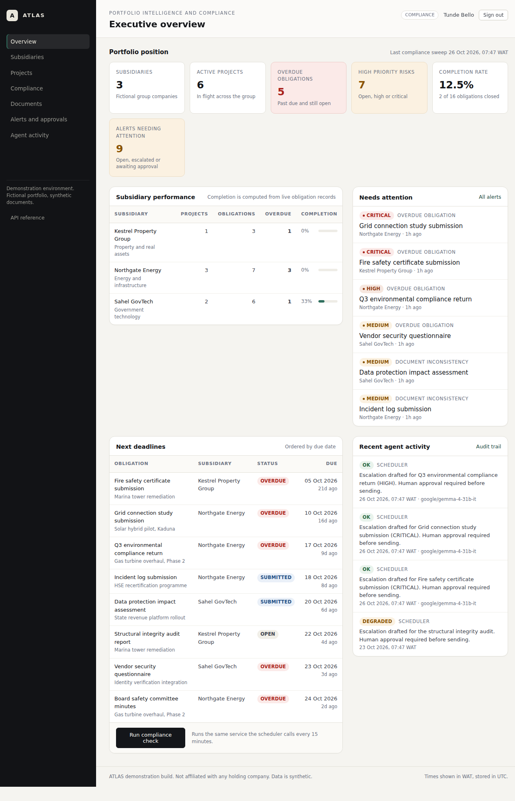

# ATLAS

Portfolio intelligence and autonomous compliance monitoring for a holding company.

ATLAS is an independent demonstration project. It is not affiliated with, endorsed by, or built for any holding company. Every subsidiary, project, obligation, document, and person in it is fictional, and the seed data is generated relative to the moment you run it so the demonstration never goes stale.

What it does: it watches a portfolio of obligations, decides deterministically when something is late or missing, drafts an escalation, and refuses to send anything until a named human approves it. Every step is recorded.



## Live demo

<https://education-estimated-hung-planner.trycloudflare.com>

Sign in with any demo account, all data is synthetic:

- `adaeze.okonkwo@atlas.demo`, executive, read only
- `tunde.bello@atlas.demo`, compliance operator, can sweep, upload, approve

Password for all three accounts is `AtlasDemo!2026`. The hosted instance runs with the scheduler enabled, so compliance sweeps happen without anyone touching it. The database can be returned to its seeded state at any time with `npm run reset && npm run seed`.

The demo is served through a temporary Cloudflare tunnel from a development machine. If the link does not answer, the deployment steps below reproduce the same instance locally in about five minutes.

## Screens

| Screen | What it shows |
| --- | --- |
| [Sign in](docs/screenshots/00-login.png) | The entry point |
| [Executive overview](docs/screenshots/01-overview.png) | Live KPIs, subsidiary completion, overdue work, next deadlines |
| [Alerts and approvals](docs/screenshots/02-alerts.png) | Every open case, ordered by severity |
| [Escalation awaiting decision](docs/screenshots/03-alert-approval.png) | A model drafted escalation, held for human approval |
| [Document assessment](docs/screenshots/04-document-analysis.png) | Facts, rule findings, and a labelled model interpretation of a submitted DPIA |
| [Agent activity and audit](docs/screenshots/05-audit.png) | Agent runs with durations, and the append only audit trail |
| [Compliance centre](docs/screenshots/06-compliance.png) | Overdue register, manual sweep trigger, check history |
| [Documents](docs/screenshots/07-documents.png) | Controlled intake and submissions with AI finding counts |

## What actually works

Verified by the test suite and by hand against a running instance:

- **Executive dashboard** where every figure is a live SQL aggregate, not a hardcoded number. Loading, empty, and error states are implemented.
- **Compliance engine** that runs on a real schedule inside the process and on demand through the same service. It finds past due obligations, flags incomplete submissions, writes a risk, raises an alert, records the check, and never duplicates an unresolved alert.
- **Bounded agent** that retrieves evidence, applies deterministic policy, drafts an escalation with a model when one is configured, validates the output against a schema, and files an approval request. It has no tools and cannot execute anything.
- **Human approval** with four guards: role check, CSRF, single-use transition under a row lock, and a state fingerprint that refuses execution if the obligation changed after review.
- **Document intake** for `.txt` and `.md` under 256 KB, with mechanical facts, deterministic rule findings, and a validated model assessment, each labelled by provenance so an interpretation is never displayed as a fact.
- **Audit trail** that records what triggered an action, what evidence was used, what was decided, and what happened, with the table refusing updates and deletes.
- **33 automated tests**, including the full acceptance workflow and the negative cases: rejected approval, stale approval, duplicate execution, invalid transition, unauthorised access, forged CSRF token, malformed model output, invalid upload.

Where a capability is absent, the interface says so. Delivery is in application only, the record says `simulated: true` and `external_delivery: none`, and the agent run is marked `DEGRADED` when no model is configured rather than pretending a model wrote the text.

## Architecture, briefly

One Node process, TypeScript executed directly by Node 22.6 or newer with no build step, server rendered HTML, PostgreSQL, and plain SQL migrations.

```
Browser ──HTTP──▶ Fastify (src/server.ts)
                    ├── session auth, RBAC, CSRF, rate limits, upload limits
                    ├── views/         server rendered pages, one CSS file
                    ├── portfolio.ts   read models, live SQL aggregates
                    ├── compliance.ts  deterministic rules, sweep, advisory lock
                    ├── agent.ts       bounded agent, approvals, execution
                    ├── documents.ts   intake, extraction, provenance
                    └── ai.ts          OpenAI compatible client, schema validation
                                        │
                                   PostgreSQL 16
```

The brief suggested Next.js plus NestJS plus Prisma. I chose one Fastify process instead, and the reasoning is recorded in [docs/DECISIONS.md](docs/DECISIONS.md). The short version: three deployables, a client build, and an ORM engine add failure modes that do not improve this demonstration, and the compliance and approval logic, which is what the role is actually about, is identical either way. The trade-off is that interactive filtering and optimistic UI are server round trips; at this data volume that is invisible.

## Run it locally

Requirements: Node 22.6+, PostgreSQL 14+, npm.

```bash
# 1. Database
sudo -u postgres psql -c "CREATE ROLE atlas LOGIN PASSWORD 'atlas'"
sudo -u postgres psql -c "CREATE DATABASE atlas OWNER atlas"
sudo -u postgres psql -c "CREATE DATABASE atlas_test OWNER atlas"

# 2. Configuration
cp .env.example .env
# edit DATABASE_URL, TEST_DATABASE_URL, SESSION_SECRET

# 3. Install and prepare
npm install
npm run migrate
npm run seed

# 4. Start
npm start            # http://127.0.0.1:8090
```

`npm run reset` truncates the domain tables and reseeds with fresh relative dates. It is the supported way to return the demonstration to a known state.

### Demo accounts

All three use the same password, `AtlasDemo!2026` unless `SEED_PASSWORD` is set:

| Email | Role | Can do |
| --- | --- | --- |
| `adaeze.okonkwo@atlas.demo` | EXEC | Read everything, run nothing |
| `tunde.bello@atlas.demo` | COMPLIANCE | Read, run checks, upload, approve |
| `ifeoma.eze@atlas.demo` | ADMIN | Everything above, plus future user management |

These are demonstration credentials. Do not reuse this seed on a host you care about without changing them.

## The workflow to demonstrate

1. Sign in as **Tunde Bello** and open **Compliance**. The seeded data includes obligations that are already past due and not yet assessed.
2. Press **Run compliance check**. The page reports how many obligations were scanned, how many alerts were raised, and how many agent runs were recorded.
3. Open an **OVERDUE OBLIGATION** alert with HIGH or CRITICAL severity. The evidence paragraph names the obligation, the subsidiary, the due date, the days late, and whether any evidence was filed.
4. Read the **escalation awaiting your decision** block. It shows the drafted subject and body, and whether it came from the model or from policy text.
5. Press **Approve and record escalation**. The alert moves to ESCALATED and an action row is written with `simulated: true`.
6. Press **Run compliance check** again. It reports zero new alerts and zero new agent runs. That is the idempotency guarantee, not a cached page.
7. Open **Agent activity** to see the run, the model, the duration, and the audit events for the approval and the execution.
8. To see the staleness guard, open a different pending approval, then upload a document against its obligation in another tab, then approve. Execution is refused, the approval is marked EXPIRED, and a fresh assessment with a new fingerprint is queued.
9. To see a rejection, reject an approval. No action row exists for it.

Uploads: **Documents**, choose an obligation, attach a `.txt` or `.md` file. Try `samples/dpia-identity-verification.txt`. The DPIA in the seed deliberately states a seven year retention against a three year schedule, so a configured model should surface that inconsistency, while the deterministic rules independently report the missing attestation section.

## Tests

```bash
npm test          # 31 tests, requires the atlas_test database
npm run typecheck # tsc --noEmit, strict
```

- `tests/rules.test.ts` covers the policy surface: severity thresholds, fingerprint sensitivity, dedupe keys, section requirements, upload validation, and schema rejection of malformed model output.
- `tests/acceptance.test.ts` covers the full acceptance workflow: sweep, alert, agent run, approval, execution, audit, duplicate suppression, rejection, staleness, double execution, invalid transitions, and concurrent sweeps.
- `tests/http.test.ts` covers the boundary: unauthenticated access, generic login failure, security headers, RBAC, CSRF, clean 404s, identifier validation, and session destruction.

The suite truncates and reseeds the test database. Never point `TEST_DATABASE_URL` at a database you want to keep.

## API

Session cookie authentication. Every mutating call also requires the `x-csrf-token` header, which is the token embedded in the pages.

| Method | Path | Purpose |
| --- | --- | --- |
| GET | `/api/summary` | Portfolio KPIs, computed live |
| GET | `/api/subsidiaries` | Performance by subsidiary |
| GET | `/api/projects?status=&subsidiary=` | Project list |
| GET | `/api/obligations/:id` | Obligation with documents, alerts, approvals |
| GET | `/api/alerts?status=&severity=` | Alert list |
| GET | `/api/checks` | Compliance check history |
| GET | `/api/runs` | Agent run history |
| GET | `/api/audit?entityType=&limit=` | Audit events |
| POST | `/api/compliance/run` | Same service the scheduler calls |
| POST | `/api/documents` | Multipart upload: `file`, `obligationId` |
| GET | `/healthz` | Process, database latency, scheduler state, model state |

Responses are `{ "data": ... }` or `{ "error": { "code", "message" } }`. Stack traces and database messages are never returned. `/api/docs` prints the same table as plain text.

## Data model

Thirteen domain tables: `app_user`, `session`, `subsidiary`, `project`, `obligation`, `document`, `document_finding`, `compliance_check`, `agent_run`, `alert`, `risk`, `approval`, `action`, and the append only `audit_event`.

Design decisions worth knowing:

- Money is `numeric(16,2)`, never floating point.
- Every stored timestamp is `timestamptz`; display is `Africa/Lagos` and labelled WAT.
- Statuses are `CHECK` constrained text, so illegal states fail at the database, not only in code.
- `alert` has a partial unique index on `dedupe_key` where the alert is unresolved. Re-running a sweep cannot duplicate an open alert, but a resolved condition can raise a new one later.
- `approval` has a partial unique index allowing one PENDING approval per alert.
- `approval.state_fingerprint` hashes the obligation id, status, due date, version, and updated time. Execution compares it again.
- JSON is used only where the shape is genuinely variable: agent evidence and proposed actions, approval payloads, audit detail, and action results. Everything queryable is a column.
- `audit_event` has a trigger that raises on UPDATE or DELETE.

Full column level detail, relationships, and lifecycle rules are in [docs/DATA-MODEL.md](docs/DATA-MODEL.md).

## Security and data protection

- Passwords are scrypt hashed with per-user salt, compared in constant time.
- Sessions are opaque random ids stored server side, delivered as an HMAC signed cookie, `HttpOnly`, `SameSite=Lax`, `Secure` when `COOKIE_SECURE=1`.
- Authorisation is enforced server side on every route; the UI merely hides what a role cannot do.
- CSRF tokens are per session and verified on every state change.
- Login is rate limited per IP, uploads are separately limited, and the global limiter is off by default except where annotated.
- Uploads are restricted by extension, MIME type, and size, then treated as untrusted text. Files are never executed, and no shell, filesystem, or network tool is exposed to the model.
- The model receives a capped excerpt with explicit instructions that document text is data, and its output must pass a schema before anything is stored.
- Errors are generic at the boundary; details go to the server log.
- No secrets are committed. `.env` is ignored and `.env.example` holds placeholders.

On the Nigeria Data Protection Act 2023: the design anticipates the principles by minimising collected personal data, limiting retention, restricting access by role, and logging access to records. That is not a claim of legal compliance. No DPIA has been filed for this demonstration, no data protection officer has reviewed it, and it has not been independently security tested. [docs/SECURITY.md](docs/SECURITY.md) sets out the limits precisely.

## Deployment

The application is a single Node process plus PostgreSQL. It needs no build step and no static asset pipeline.

1. Provision PostgreSQL and set `DATABASE_URL`.
2. Set `SESSION_SECRET`, `COOKIE_SECURE=1`, `HOST=0.0.0.0`, and the AI variables if you want model calls.
3. Run `npm ci && npm run migrate` as a release step, then `npm run seed` once if you want the demonstration data.
4. Start with `npm start` behind TLS. Terminate TLS at the platform proxy and keep `trustProxy` enabled as it is.
5. Point the platform health check at `/healthz`.

The scheduler is real scheduled execution, but it lives inside the process. If the host sleeps or restarts, sweeps pause with it. For a host that does not guarantee a long lived process, disable the internal scheduler and call `POST /api/compliance/run` from the platform cron with a service account. That path uses the same service, so behaviour is identical. This is documented rather than hidden because a dashboard that says "continuous monitoring" while nothing runs is worse than an honest pause.

## What is deliberately not built

- Email, Teams, or SMS delivery. Approvals execute as in application delivery and are labelled simulated.
- PDF, DOCX, or OCR intake. Text formats only, by design for the demonstration window.
- A predictive risk model. Risk severity is policy, not prediction.
- Multi-tenant isolation, user administration, and password reset.
- Tamper proof audit storage. Append only at the application and database level is not cryptographic immutability; an operator with superuser rights could disable the trigger.
- Kubernetes, queues, microservices, and event buses. There is no load in this demonstration that would justify them.

## Repository layout

```
src/
  server.ts        routes, auth wiring, error handling, security headers
  compliance.ts    the sweep: rules, alerts, risk, idempotency, locking
  agent.ts         bounded agent, approval decisions, execution, fingerprint guard
  documents.ts     intake, extraction, deterministic findings, AI assessment
  ai.ts            provider client, schemas, prompt hardening, deterministic fallback
  portfolio.ts     read models for pages and API
  obligations.ts   guarded status transitions
  auth.ts          scrypt, sessions, signing, RBAC
  audit.ts         append only audit writes
  rules.ts         pure policy functions
  views/           layout and page templates, escaping helpers
migrations/        versioned SQL, applied by scripts/migrate.ts
scripts/           migrate, seed, reset
tests/             unit, acceptance, HTTP
docs/              architecture, data model, security, runbook, decisions, demo script
public/app.css     the whole design system
samples/           synthetic documents for the upload walkthrough
```

## Licence

MIT. The fictional company names and data are illustrative only.
